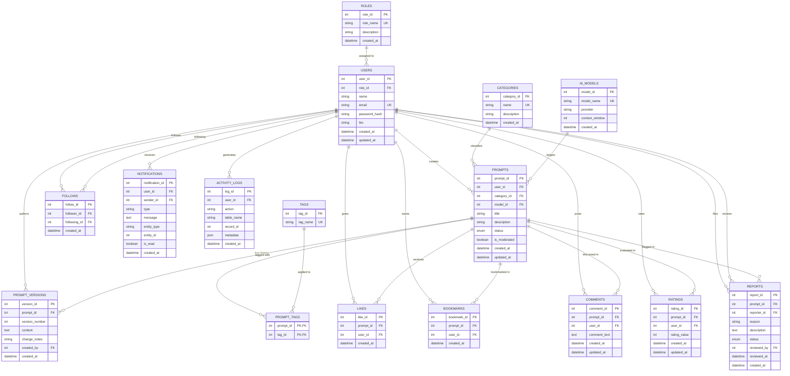

# Entity Relationship Diagram (ERD) — PromptForge

**Platform**: PROMPTFORGE — AI Prompt Management Platform  
**Database Engine**: MySQL 8.0+ (InnoDB)  
**Normalization Target**: Third Normal Form (3NF)  

---

## 1. Relational Architecture Diagram

The relational model consists of **16 normalized entities** designed in accordance with Third Normal Form (3NF) to eliminate data redundancy and preserve full referential integrity.

---

## 2. Entity Dictionary & Referential Integrity Rules

### 1. `roles`
- **Primary Key**: `role_id` (INT, AUTO_INCREMENT)
- **Alternate/Candidate Key**: `role_name` (VARCHAR(50), UNIQUE)
- **Purpose**: Defines system privileges (`ADMIN`, `USER`).

### 2. `users`
- **Primary Key**: `user_id` (INT, AUTO_INCREMENT)
- **Candidate Key**: `email` (VARCHAR(150), UNIQUE)
- **Foreign Keys**: `role_id` -> `roles(role_id)` ON DELETE RESTRICT ON UPDATE CASCADE
- **Purpose**: Represents registered user and creator accounts.

### 3. `categories`
- **Primary Key**: `category_id` (INT, AUTO_INCREMENT)
- **Candidate Key**: `name` (VARCHAR(100), UNIQUE)
- **Purpose**: Standardizes taxonomy for prompts (Software Engineering, Academic & Research, etc.).

### 4. `ai_models`
- **Primary Key**: `model_id` (INT, AUTO_INCREMENT)
- **Candidate Key**: `model_name` (VARCHAR(100), UNIQUE)
- **Purpose**: Tracks target LLMs (GPT-4o, Claude 3.5 Sonnet, Gemini 1.5 Pro) with context window attributes.

### 5. `prompts`
- **Primary Key**: `prompt_id` (INT, AUTO_INCREMENT)
- **Foreign Keys**:
  - `user_id` -> `users(user_id)` ON DELETE CASCADE ON UPDATE CASCADE
  - `category_id` -> `categories(category_id)` ON DELETE RESTRICT ON UPDATE CASCADE
  - `model_id` -> `ai_models(model_id)` ON DELETE RESTRICT ON UPDATE CASCADE
- **Purpose**: Core prompt entity managing metadata, publication state, and moderation flags.

### 6. `prompt_versions`
- **Primary Key**: `version_id` (INT, AUTO_INCREMENT)
- **Composite Unique Key**: `(prompt_id, version_number)`
- **Foreign Keys**:
  - `prompt_id` -> `prompts(prompt_id)` ON DELETE CASCADE ON UPDATE CASCADE
  - `created_by` -> `users(user_id)` ON DELETE RESTRICT ON UPDATE CASCADE
- **Purpose**: Implements non-destructive versioning. Modifications append a new incremental version without deleting history.

### 7. `tags`
- **Primary Key**: `tag_id` (INT, AUTO_INCREMENT)
- **Candidate Key**: `tag_name` (VARCHAR(50), UNIQUE)
- **Purpose**: Atomic keywords for search and discovery.

### 8. `prompt_tags`
- **Composite Primary Key**: `(prompt_id, tag_id)`
- **Foreign Keys**:
  - `prompt_id` -> `prompts(prompt_id)` ON DELETE CASCADE ON UPDATE CASCADE
  - `tag_id` -> `tags(tag_id)` ON DELETE CASCADE ON UPDATE CASCADE
- **Purpose**: Resolves the Many-to-Many relationship between Prompts and Tags.

### 9. `likes`
- **Primary Key**: `like_id` (INT, AUTO_INCREMENT)
- **Composite Unique Key**: `(prompt_id, user_id)` (prevents duplicate likes)
- **Foreign Keys**:
  - `prompt_id` -> `prompts(prompt_id)` ON DELETE CASCADE ON UPDATE CASCADE
  - `user_id` -> `users(user_id)` ON DELETE CASCADE ON UPDATE CASCADE

### 10. `bookmarks`
- **Primary Key**: `bookmark_id` (INT, AUTO_INCREMENT)
- **Composite Unique Key**: `(prompt_id, user_id)` (prevents duplicate bookmarks)
- **Foreign Keys**:
  - `prompt_id` -> `prompts(prompt_id)` ON DELETE CASCADE ON UPDATE CASCADE
  - `user_id` -> `users(user_id)` ON DELETE CASCADE ON UPDATE CASCADE

### 11. `comments`
- **Primary Key**: `comment_id` (INT, AUTO_INCREMENT)
- **Foreign Keys**:
  - `prompt_id` -> `prompts(prompt_id)` ON DELETE CASCADE ON UPDATE CASCADE
  - `user_id` -> `users(user_id)` ON DELETE CASCADE ON UPDATE CASCADE

### 12. `ratings`
- **Primary Key**: `rating_id` (INT, AUTO_INCREMENT)
- **Composite Unique Key**: `(prompt_id, user_id)` (one active rating per user per prompt)
- **Domain Constraint**: `CHECK (rating_value BETWEEN 1 AND 5)`
- **Foreign Keys**:
  - `prompt_id` -> `prompts(prompt_id)` ON DELETE CASCADE ON UPDATE CASCADE
  - `user_id` -> `users(user_id)` ON DELETE CASCADE ON UPDATE CASCADE

### 13. `follows`
- **Primary Key**: `follow_id` (INT, AUTO_INCREMENT)
- **Composite Unique Key**: `(follower_id, following_id)`
- **Tuple Constraint**: `CHECK (follower_id <> following_id)` (prevents self-following)
- **Foreign Keys**:
  - `follower_id` -> `users(user_id)` ON DELETE CASCADE ON UPDATE CASCADE
  - `following_id` -> `users(user_id)` ON DELETE CASCADE ON UPDATE CASCADE

### 14. `notifications`
- **Primary Key**: `notification_id` (INT, AUTO_INCREMENT)
- **Foreign Keys**:
  - `user_id` -> `users(user_id)` ON DELETE CASCADE ON UPDATE CASCADE
  - `sender_id` -> `users(user_id)` ON DELETE SET NULL ON UPDATE CASCADE

### 15. `reports`
- **Primary Key**: `report_id` (INT, AUTO_INCREMENT)
- **Foreign Keys**:
  - `prompt_id` -> `prompts(prompt_id)` ON DELETE CASCADE ON UPDATE CASCADE
  - `reporter_id` -> `users(user_id)` ON DELETE CASCADE ON UPDATE CASCADE
  - `reviewed_by` -> `users(user_id)` ON DELETE SET NULL ON UPDATE CASCADE

### 16. `activity_logs`
- **Primary Key**: `log_id` (INT, AUTO_INCREMENT)
- **Foreign Keys**:
  - `user_id` -> `users(user_id)` ON DELETE SET NULL ON UPDATE CASCADE
- **Purpose**: System-wide traceability and audit trail for all transactional mutations.
